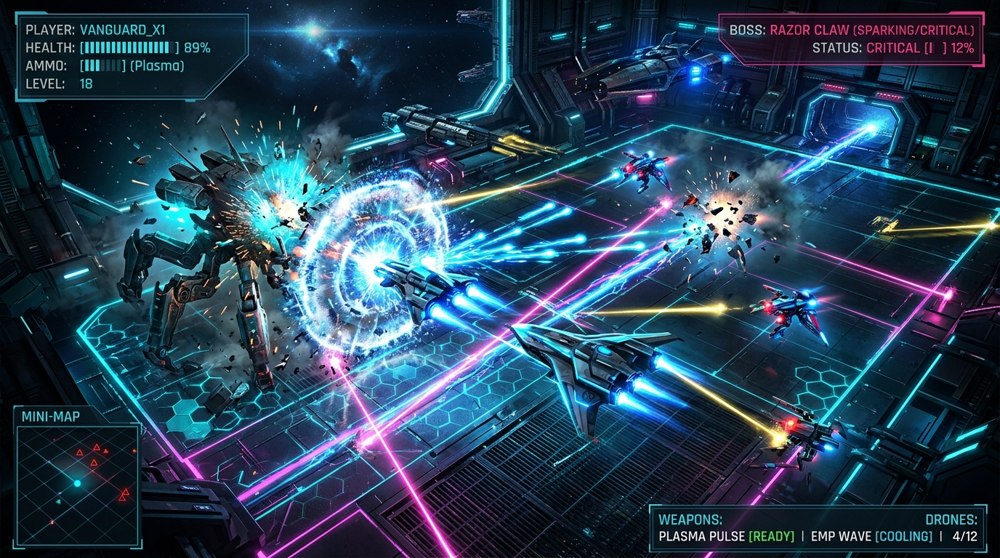

<div align="center">



# ◈ NEON STRIKE // ASHES OF ORBIT
### *Power-Build Action Arena Shooter & Orbital Campaign*

[](https://tiraxmunna.github.io/Neon/)
[](LICENSE)
[](https://developer.mozilla.org/en-US/docs/Web/API/Canvas_API)
[](https://developer.mozilla.org/en-US/docs/Web/API/Web_Audio_API)
[](index.html)
[-white?style=for-the-badge)](index.html)

<br/>

> **"The orbital frontier is dark. An autonomous rogue network has seized the defense grid. Pilot the Vanguard, draft experimental military upgrades, dismantle the security legions, and silence the central AI Oblivion."**

---

### [🚀 Play Instantly in Your Browser](https://tiraxmunna.github.io/Neon/) &bull; [🕹️ Controls](#-flight--combat-controls) &bull; [⚡ Power Build System](#-the-power-build-system) &bull; [🗺️ Mission Dossier](#-mission-dossier--the-8-sectors)

---

</div>

<br/>

## 🌌 Overview

**NEON STRIKE: Ashes of Orbit** is a self-contained, browser-playable top-down sci-fi action campaign. It runs anywhere with **zero installation, no node modules, no external assets, and zero API dependencies**. Every visual particle, laser beam, furnace lane hazard, and sound effect is generated procedurally on-the-fly via HTML5 Canvas 2D and the Web Audio API.

### 🎮 What Makes Neon Strike Unique?
- 💥 **Cumulative Power-Draft Roguelite Progression**: Choose 1 of 3 specialized combat upgrades before every level. Unlike standard games where old abilities get replaced, **every single pick stacks permanently**—wielding up to 8 game-altering augmentations by the final boss confrontation.
- ⚡ **Tactical Combat Rhythm**: Seamlessly weave between **Phase Dash** invulnerability windows, directional kiting, and screen-clearing **EMP Surges**.
- 🛡️ **Dynamic Clutch Healing**: Advanced danger-detection increases enemy integrity shard drop rates up to 28% when suit health falls below critical thresholds, enabling epic comebacks.
- 📱 **Universal Cross-Platform**: Responsive layout natively supporting desktop keyboard + mouse and mobile/tablet touchscreen virtual joystick with precision auto-aim.
- 💾 **Instant Local Persistence**: Campaign checkpoints, best scores, sector unlocks, and custom operative builds automatically save to browser storage.

---

## ⚡ The Power Build System

Before deploying into each sector, requisition **one permanent power** from that sector's prototype draft. By Mission 08, your operative carries up to 8 synergistic enhancements!

```
[Level 1 Requisition] ───► [Level 2 Requisition] ───► ... ───► [Level 8 Ultimate Stack]
  (Pulse / Servo / Aegis)      (Phase / Splitter / Scavenger)      (8 Synchronized Powers Active)
```

| Sector | Code Name | Powers Offered | Tactical Archetype |
|:---:|:---|:---|:---|
| **01** | *Signal Breach* | `✦ Pulse Rounds` &bull; `ϟ Overclocked Servo` &bull; `⬡ Aegis Plating` | Damage / Fire Rate / Max Integrity |
| **02** | *Scrapline* | `⌁ Phase Capacitor` &bull; `⫶ Splitter Array` &bull; `⌑ Scavenger Instinct` | Dash Cooldown / Multi-Shot / Kill Heal |
| **03** | *The Sentinel* | `✹ Commander Bane` &bull; `ϟ EMP Amplifier` &bull; `◈ Reactive Shield` | Boss Slayer / Special Ability / Armor |
| **04** | *Black Foundry* | `＋ Nanite Recovery` &bull; `↠ Piercer Slugs` &bull; `⬢ Tempered Shell` | Auto-Regen / Piercing Ammo / Heavy Shell |
| **05** | *Ghost Protocol* | `⌖ Deadeye Matrix` &bull; `◇ Prism Chamber` &bull; `⌬ Data Leech` | Critical Hits / Heavy Rounds / Objective Siphon |
| **06** | *Titan Protocol* | `✹ Titan Breaker` &bull; `➤ Kinetic Surge` &bull; `⛨ Emergency Plating` | Anti-Armor / Combat Flow / Emergency Ward |
| **07** | *Core Breach* | `ϟ Reactor Feedback` &bull; `⌁ Phase Echo` &bull; `✚ Vital Core` | Fast EMP / Evasion Mastery / Core Sustain |
| **08** | *Last Firewall* | `✦ Oblivion Bane` &bull; `ϟ Overdrive Core` &bull; `✺ Singularity Engine` | Decimation / Hyper Fire / Ultimate Volley |

---

## 🗺️ Mission Dossier & The 8 Sectors

```
┌─────────────────────────────────────────────────────────────────────────────┐
│ 01: SIGNAL BREACH ──► 02: SCRAPLINE ──► 03: THE SENTINEL [BOSS]             │
│                                                   │                         │
│ 06: TITAN PROTOCOL ◄── 05: GHOST PROTOCOL ◄── 04: BLACK FOUNDRY             │
│        [BOSS]                                                               │
│          │                                                                  │
│          └──► 07: CORE BREACH ──► 08: LAST FIREWALL [FINAL CONFRONTATION]   │
└─────────────────────────────────────────────────────────────────────────────┘
```

1. **Sector 01 — Signal Breach (Low Threat)**
   - *Objective*: Eliminate 8 scout drones along the outer perimeter.
   - *Mechanic*: Learn strafe movements, projectile lead, and Phase Dash evasion.
2. **Sector 02 — Scrapline (Salvage Hunt)**
   - *Objective*: Recover 4 gold power cores dropped by rogue salvagers.
   - *Mechanic*: Cores drop every second elimination with vertical beacon beams. Picking up a core restores **+15 integrity** and **+15% EMP**. Beware of telegraphed scrap mines!
3. **Sector 03 — The Sentinel (Commander Duel)**
   - *Objective*: Eliminate the 6-unit guard screen, then duel the autonomous **Commander Sentinel**.
   - *Mechanic*: Dodge expanding radial volleys and triple-aimed heavy plasma bursts.
4. **Sector 04 — Black Foundry (Furnace Lockdown)**
   - *Objective*: Survive 42 seconds of automated furnace lockdowns, then clear survivors.
   - *Mechanic*: Sweeping furnace heat lanes flash orange with a 1.5s warning before incinerating the grid.
5. **Sector 05 — Ghost Protocol (Data Relay Raid)**
   - *Objective*: Infiltrate the security perimeter and destroy 3 protected data relays.
   - *Mechanic*: Relays can be shot directly and restore integrity upon destruction.
6. **Sector 06 — Titan Protocol (Heavy Commander Duel)**
   - *Objective*: Breach the escort screen and dismantle the armored **Titan Platform**.
   - *Mechanic*: Heavy cannon bursts, rotating perimeter armor shields, and low-health rage modes.
7. **Sector 07 — Core Breach (Reactor Meltdown)**
   - *Objective*: Sever 3 reactor containment locks while avoiding timed core shock pulses.
   - *Mechanic*: Expanding red blast rings detonate across the nexus floor.
8. **Sector 08 — Last Firewall (Final Confrontation)**
   - *Objective*: Confront **Oblivion**, the central network intelligence controlling the invasion.
   - *Mechanic*: Dense multi-spoke projectile walls with precision dash openings.

---

## 🕹️ Flight & Combat Controls

### Desktop (Keyboard & Mouse)
| Key / Input | Action | Tactical Description |
|:---:|:---:|:---|
| <kbd>W</kbd> <kbd>A</kbd> <kbd>S</kbd> <kbd>D</kbd> or <kbd>▲</kbd> <kbd>◄</kbd> <kbd>▼</kbd> <kbd>►</kbd> | **8-Way Thrusters** | Full omnidirectional vector navigation |
| `Mouse Aim` | **Targeting Reticle** | Precise 360-degree crosshair orientation |
| `Left Mouse` / <kbd>Spacebar</kbd> | **Primary Fire** | Sustained high-frequency plasma fire |
| <kbd>Shift</kbd> | **Phase Dash** | Rapid burst dash with invulnerability frames |
| <kbd>E</kbd> | **EMP Surge** | Discharges 100% EMP: clears all bullets & damages screen |
| <kbd>P</kbd> / <kbd>Esc</kbd> | **Tactical Pause** | Freezes combat, inspects manual and loadout |
| <kbd>R</kbd> | **Quick Retry** | Instantly redeploys with 100% full integrity |

### Touchscreen & Mobile
- **Left Joystick**: Drag inside the circular navigation pad for fluid movement.
- **FIRE Button**: Automatically tracks and targets the nearest hostile while held.
- **PHASE DASH & EMP Buttons**: Instant responsive touch triggers.

---

## 🛠️ Architecture & Tech Specs

```
neon-strike/
├── index.html              # Standalone web game (Zero dependencies, offline ready)
├── README.md               # Visual repository documentation & dossier
├── assets/
│   └── banner.jpg          # Cinematic cyberpunk header showcase
└── neon_strike_game/
    ├── index.html          # Modular packaged game build
    └── README.txt          # Quick offline reference & deployment notes
```

- **Core Engine**: Pure Vanilla ECMAScript 2026 (No React, Vue, Vite, or external bundles required).
- **Renderer**: High-DPI HTML5 Canvas 2D with dynamic radial gradient shading, chromatic vignette scanlines, procedural lighting, and particle physics.
- **Audio Synthesis**: Native `AudioContext` procedural sound synthesizer. Sound effects (plasma hums, explosions, boss warnings, dash shifts, and EMP releases) are synthesized directly through code with zero audio file downloads.
- **Storage**: Clean JSON browser local storage schema (`neonStrikeSaveV2`) preserving unlocks, power stacks, and high scores.

---

## 🌐 Deploy to GitHub Pages (Play in 30 Seconds!)

You can host this game for free with zero setup using GitHub Pages:

1. Go to your repository on GitHub: [`https://github.com/tiraxmunna/Neon`](https://github.com/tiraxmunna/Neon)
2. Click **Settings** ⚙️ &bull; **Pages** (in the left sidebar).
3. Under **Branch**, select `main` and folder `/ (root)`.
4. Click **Save**. Within 60 seconds, your game is live at:  
   **`https://tiraxmunna.github.io/Neon/`**

---

<div align="center">

Developed with 💙 for sci-fi arcade shooters &bull; **[Launch Game](https://tiraxmunna.github.io/Neon/)**

</div>
